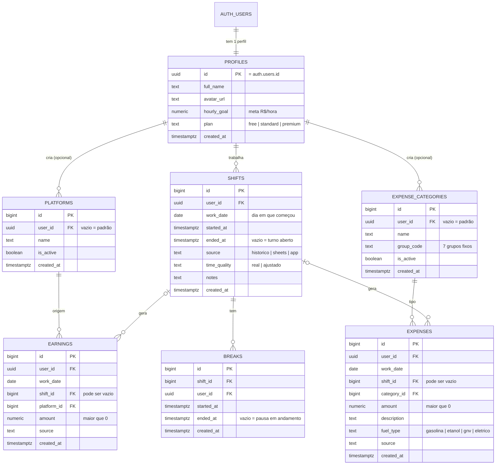

# Modelo de dados

Banco PostgreSQL hospedado no Supabase (região São Paulo).
Os arquivos que criam cada tabela estão em [`sql/`](../sql), numerados na ordem de execução.

## Diagrama

## Como ler o diagrama

| Símbolo | Significado |
|---|---|
| `\|\|` | exatamente um |
| `\|o` | zero ou um (ligação opcional) |
| `o{` | zero ou muitos |

Exemplo: `PROFILES ||--o{ SHIFTS` = **um** motorista tem **zero ou muitos** turnos.

## Regras principais

- **Segurança (RLS):** todas as tabelas têm Row Level Security. Cada motorista só vê e altera as próprias linhas (`user_id = auth.uid()`). Plataformas e categorias padrão (`user_id` vazio) são visíveis para todos, mas só o sistema altera.
- **Plano protegido:** o motorista só pode editar `full_name`, `avatar_url` e `hourly_goal` do próprio perfil; o `plan` não.
- **Perfil automático:** um trigger cria o perfil no primeiro cadastro, já com nome e foto do Google.
- **Integridade:** valores sempre positivos; turno com no máximo 24h; fim depois do início; um único turno aberto por motorista; sem turnos duplicados (`user_id` + `started_at`).
- **Exclusão:** excluir a conta apaga todos os dados do motorista (LGPD). Excluir um turno apaga as pausas, mas mantém ganhos e despesas (só desfaz a ligação).

Regras de negócio e métricas: ver [`metricas.md`](metricas.md).
